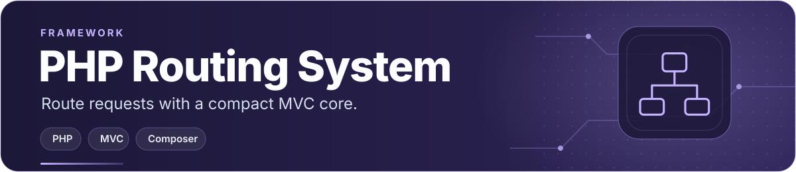

# 

A PHP MVC framework with configurable routes, controllers, views, and models. The repository includes a sample application and a public entry point.

[](https://github.com/svazqz/php-routing-system/actions/workflows/ci.yml)

[Quick start](#quick-start) · [Validation](#validation) · [Project layout](#project-layout) · [Reference](#reference) · [License](#license)

## Quick start

Install Composer dependencies and create a local configuration.

```sh
composer install
cp config.sample.ini config.ini
```

Set your web server’s document root to `public/`. The reference covers routing, database setup, and Docker Compose.

## Validation

```sh
vendor/bin/phpunit
```

Use `config.test.ini` and a test database when checking persistence.

## Project layout

| Path | Purpose |
| --- | --- |
| [`core/`](core/) | Framework code |
| [`app/`](app/) | Sample MVC application |
| [`public/`](public/) | Web document root |
| [`tests/`](tests/) | PHP test suite |
| [`config.sample.ini`](config.sample.ini) | Configuration template |

## Reference

Read the [project reference](README.reference.md) for detailed examples, configuration, and original notes.

## License

See [`LICENSE`](LICENSE) for license terms.
